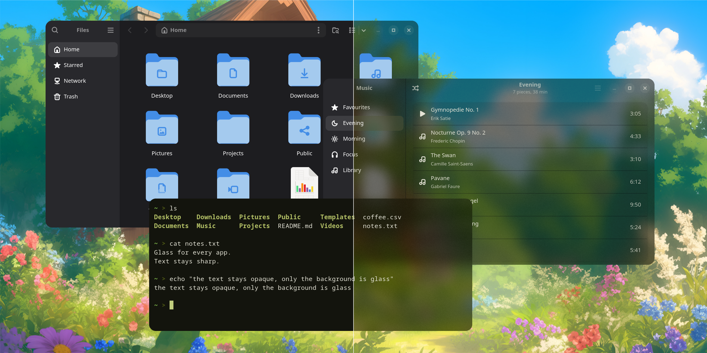
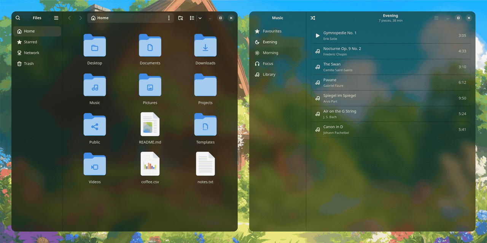
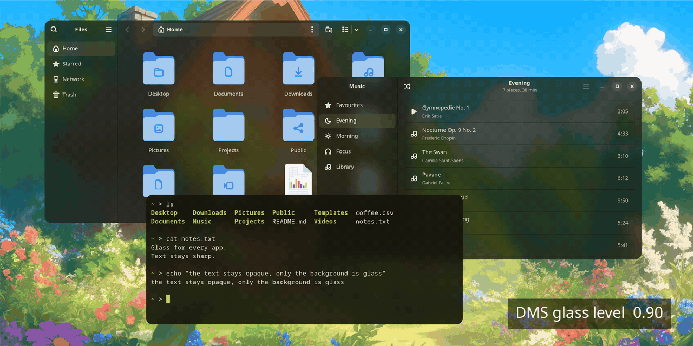
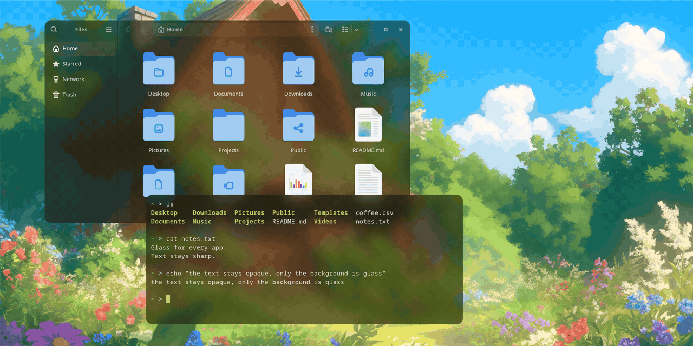

<div align="center">



*Left: without appGlass. Right: with appGlass.*

**Glass backgrounds for desktop apps on [DMS](https://github.com/duxlabs-dev/dux-shell) + niri.**

Your wallpaper shows through the app. Text, icons and logos stay sharp.
The glass level follows your DMS window opacity.

[Getting started](#getting-started) · [Features](#features) · [Usage](#usage) · [Settings](#settings) · [Troubleshooting](#troubleshooting) · [Roadmap](#roadmap) · [User guide](docs/guide.md) · [Changelog](CHANGELOG.md)

</div>

> [!NOTE]
> **Early version.** appGlass works today for the apps marked **Works** in the [route table](#which-apps-get-glass). Some routes wait for a hidden check before they go live. Apps with no route stay opaque and sharp.

## Getting started

### Requirements

| Dependency | Version | Needed for |
| --- | --- | --- |
| DMS (Dux Modular Shell, formerly DankMaterialShell) | 2.0.0 or newer | The glass level and the settings page |
| niri | Any recent version | The window rules |
| Python | 3.11 or newer, standard library only | Everything (`appglass` is a Python program) |
| `gcc` | Any | The small C shims (Lian Li, LocalSend, ArtCraft) |
| EGL headers (`EGL/egl.h`) | Any | The colour-key shim (LocalSend, and ArtCraft when its Vulkan layer cannot run) |
| Vulkan headers (`vulkan/vk_layer.h`) | Any | The Vulkan layer (ArtCraft) |
| `g++`, Qt 6 headers, `moc` and `pkg-config` | Qt 6 | VLC (its Qt style plugin is built from source) and the Qt shims |
| Host Qt | 6.11 or newer | Jellyfin Desktop only |
| A DMS window rule with an opacity | No match, blur on | The glass level itself (optional, see below) |
| `gamescope`, `niri`, `dbus-run-session` and `ffmpeg` | Any | The hidden check of the Forced and Mod routes. Without them the check cannot run, and those routes stay plain |
| `bwrap` (bubblewrap), with user namespaces | Any | The hidden check of a flatpak app on a Forced or Mod route |
| `jq` | Any | Putting Vencord back after a Discord update, with the Vencord installer CLI kept at `~/.local/share/appglass/VencordInstallerCli-linux` ([how](docs/routes.md#discord-vencord)) |

**The glass level** is the opacity of your global DMS window rule. Make one in **Settings → Applications → Window rules**: a rule with no match (it applies to every window), an opacity, and blur on. appGlass takes the first such rule, whatever you call it. With no such rule it uses the DMS `foregroundLayerTransparency` setting, then 0.60.

### 1. Install

appGlass is not in the DMS plugin registry. It installs with git:

```sh
git clone https://github.com/lung595/appGlass ~/.local/share/appglass
cd ~/.local/share/appglass
bin/appglass plugin install         # link the DMS plugin into the DMS plugins folder
bin/appglass hook install           # re-apply on every DMS theme or level change, and route new apps
bin/appglass apply --all --dry-run  # preview: the files it would write; changes nothing
bin/appglass apply --all            # write the glass files for every app it supports
```

To type `appglass` instead of `bin/appglass`, link it into your PATH:

```sh
ln -s ~/.local/share/appglass/bin/appglass ~/.local/bin/
```

The rest of this page writes `appglass` for short.

<details>
<summary>Updating</summary>

```sh
cd ~/.local/share/appglass && git pull
appglass doctor --fix   # the hook and units, as the new version writes them
appglass apply --all    # the glass files, as the new version writes them
dms restart             # reload the plugin's code; your settings are kept
```

Then restart the apps whose glass changed.
</details>

### 2. Enable

In **Settings → Plugins**, turn **App Glass** on. If it does not show up, click **Settings → Plugins → Manage Registries → *Scan***.

### 3. Add a widget

The widget is optional. The glass works without it.

**Settings → Bar widgets → Add widget**, then pick **App Glass**. The bar pill shows how many apps are on glass. A click opens the settings. A right click pauses or resumes the glass.

### 4. First steps

1. **Restart your apps.** Most apps read their colours only when they start. Alacritty, Herdr and Dux Files reload live.
2. **Quit Obsidian before the first apply.** It needs one restart the first time. After that it reloads live.
3. Open **Settings → Plugins → App Glass → Apps** to see which app got which route.

## Features

| Unfocused windows fade |
| --- |
| [](docs/media/unfocused-fade.gif) |
| *Shown at level 0.80 with a 20 % fade amount.* |

| The level follows DMS |
| --- |
| [](docs/media/levels.gif) |
| *The DMS window rule opacity at 0.90, 0.75 and 0.60.* |

| A new app gets glass |
| --- |
| [](docs/media/new-app.gif) |
| *The window opens with glass. No command needed.* |

The GIFs are crossfades between real screenshots, taken in a separate test session. The level label in the second GIF was added afterwards. The music window is a small libadwaita demo app: it gets its glass from the GTK4 CSS that libadwaita apps read, so it needs no routing. Plain GTK4 apps without libadwaita stay opaque (not tested). Apps of other toolkits are routed by the sync unit within seconds.

- **Only the background turns glass.** niri keeps the window at `opacity 1.0`. Each app paints its own background with alpha. Text, icons and logos stay fully opaque.
- **Three levels, from one number.** Content follows the DMS level. Bars (header bars, sidebars, tab bars) stay at `max(content, 0.65)`. Menus, popovers and dialogs stay opaque.
- **Colours follow DMS.** A wallpaper or scheme change re-renders the app colours through the matugen hook.
- **Unfocused windows fade a little more**, on the GTK4, GTK3 and Qt Widgets routes, Alacritty, Obsidian, Discord (Vencord), Feishin, Jellyfin and Lian Li. Only the background fades. The text stays opaque. The other routes do not fade yet (see the [Roadmap](#roadmap)).
- **New and updated apps are found on their own.** A new app is routed within seconds.
- **Safe by default.** Every file it writes or edits is recorded and backed up first. `appglass remove` puts everything back byte for byte.
- **Never touched:** games, root GUIs, the windows DMS draws itself, and Firefox-family browsers (those belong to [browserGlass](https://github.com/lung595/browserGlass)).

### Which apps get glass

Each kind of app has a route. In **Settings → Apps**, a row shows the app's route and its kind under the name (for example `gtk4 · Native`). The kind tells you how the app gets its glass:

- **Native**: the app's own colour or theme files. On at once.
- **Forced**: a small shim or hook, started by a wrapper. On by default, but live only once a hidden check passes.
- **Mod**: a client mod's theme. Same rule as Forced.

The status chip on the right of the row tells you what the app has now:

- **Glass**: the route is applied.
- **Waiting for check**: a Forced or Mod route waits for its first hidden check. The app runs plain until then.
- **Stale**: the app was updated, so its old check no longer counts. The app runs plain until the next check passes.
- **Paused**: the glass is paused, or you switched a Native app off.
- **Conflict**: a hand-made file that appGlass does not own is in the way.
- **Fallback**: no route for this app, its family is not installed, its hidden check failed, or you switched a Forced or Mod app off. It gets the fallback look from **Settings → Fallback**: opaque by default, translucent (text too), or the DMS opacity.
- **Opaque**: kept opaque on purpose, in every fallback mode. The window stays opaque and sharp.
- **Game: never touched**: a game. Opaque, with blur off.
- **Delegated**: owned by someone else: Firefox-family browsers belong to browserGlass. Windows DMS draws itself show as Delegated too. appGlass never touches them.

The status is what [docs/apps.md](docs/apps.md) measured: **Works** (glass, measured in a test session), **Partial** (glass with known gaps, listed there) or **Untested** (only the config writer is tested).

| Route | Kind | Apps | Status |
| --- | --- | --- | --- |
| Terminal opacity key | Native | Alacritty, foot, Konsole | Works |
| Terminal opacity key | Native | kitty, Ghostty, WezTerm | Untested |
| GTK4 CSS | Native | Nautilus, GNOME Text Editor, Mission Center | Works |
| GTK4 CSS | Native | Resources | Works; popups not checked (no menu was opened) |
| GTK4 CSS | Native | GNOME Software, Zenity, the file chooser, Flatseal, other libadwaita apps | Untested: the same CSS, not launched; plain GTK4 apps without libadwaita stay opaque (not tested) |
| GTK3 theme | Native | Solaar, nvidia-settings | Partial: dialog bodies stay opaque |
| GTK3 theme | Native | Other host GTK3 apps | Untested |
| Qt style plugin | Native | VLC, Kate, Konsole (flatpak) | Works |
| Qt style plugin | Native | Other host Qt 6 Widgets apps | Untested |
| App config | Native | Kate (editor theme), mpv, GIMP 3 | Works |
| App config | Native | Zed | Partial: Zed lays its own dark floor under the glass |
| App theme | Native | Obsidian, Herdr, Dux Files, Dux Calendar | Partial: depends on the vault theme (Obsidian), some panes keep their fills (Herdr), bars clearer than content (Dux) |
| Vencord theme | Mod | Discord with Vencord | Partial, after its check: needs the Vencord client mod |
| Electron inspector hook | Forced | Feishin | Works, after its check |
| Electron inspector hook | Forced | VSCodium | Works, after its check; popups not checked (no menu was opened) |
| WebKit shim | Forced | Lian Li Linux | Works, after its check |
| Generic WebKitGTK route | Forced | Other WebKitGTK and Tauri apps | Being added |
| Qt Quick shim | Forced | Jellyfin Desktop | Works, after its check |
| Colour-key shim | Forced | LocalSend, ArtCraft Launcher | Works, after its check |
| None | None | Steam, Chrome, Java, Tk, X11 apps of other toolkits, Electron apps with no hook | Fallback: opaque by default, they follow the fallback mode |
| None | None | Games, root GUIs, Qt flatpaks on the KDE runtime (Kate and Konsole excepted) | Opaque: in every fallback mode |

Steam shows an old route, `steam-cdp · Forced`, with a switch in **Settings → Apps**. That switch does nothing: on or off, Steam shows *Fallback* and follows the fallback mode.

What each route writes, and the measured result per app: [docs/routes.md](docs/routes.md) and [docs/apps.md](docs/apps.md).

## Usage

**The glass level.** Change the opacity of your global rule in **Settings → Applications → Window rules** (the first rule with no match and blur on). appGlass sees the change and re-applies.

**A new app.** Install it and open it. The sync unit routes it within seconds. **Re-apply** in Settings → Glass, or `appglass apply --all`, does it at once.

**Pause.** Click **Pause glass** at the top of the settings page, or right click the bar pill. A pause takes the glass files out of every app and keeps the hook. Resume puts the same glass back.

**One app off.** In **Settings → Apps**, switch the app off. A Forced or Mod app loses its files and gets the fallback look. A Native app shows *Paused*, but keeps its files. To take a whole Native family out, use its family name (for example `gtk3`):

```sh
dms ipc call appGlass app gtk3 off
dms ipc call appGlass app gtk3 on
```

**Restart needs.** GTK apps and Dux Calendar pick up a change when they restart. Alacritty, Herdr and Dux Files reload live.

**Uninstall.** **Settings → Advanced → Uninstall appGlass**, then confirm. Or from a terminal:

```sh
appglass remove && appglass plugin remove
```

Every file is put back byte for byte. The hook and the user units go too. Your other DMS plugins are not touched. Then delete the clone if you like, and the link you made in Install:

```sh
rm ~/.local/bin/appglass
```

## Settings

Open **Settings → Plugins → App Glass**. A search field sits on top (**Ctrl+F** or **/**). The pages are on the left.

| Page | What is there |
| --- | --- |
| **Glass** | **Glass for desktop apps** (the main switch), **Glass level** (read-only, from DMS), **Apps on glass**, **Re-apply** |
| **Apps** | The **App list**: one row per app, with its status chip, route and kind, reason and switch |
| **Fade** | **Fade unfocused windows** (on), **Fade amount** (0 to 20 %, default 10 %), **Fade duration** (0 to 400 ms, default 180 ms), **Fade easing**, **Dim apps that cannot fade** (off) |
| **Fallback** | **Apps without glass**: Opaque (default), Translucent (text too), or DMS opacity. **Fallback opacity** (50 to 100 %, default 70 %) |
| **Advanced** | **Learn open windows**, **Adopt hand-made files**, **Copy report**, **Uninstall appGlass** |
| **About** | **Version**, **Never touched**, **Command line** |

The fade never goes below 60 %. At the default level of 0.60 there is no visible fade until you raise the level.

Full details: [docs/plugin.md](docs/plugin.md).

## Command line and keybindings

The DMS plugin answers these calls:

```sh
dms ipc call appGlass status            # the last status, as JSON
dms ipc call appGlass sync              # re-apply from the current settings
dms ipc call appGlass toggle            # pause or resume; answers "glass on" or "glass off"
dms ipc call appGlass pause
dms ipc call appGlass resume
dms ipc call appGlass app <key> on|off  # one app or family
```

Bind one in niri, for example in `~/.config/niri/config.kdl`:

```kdl
binds {
    Mod+Shift+G { spawn "dms" "ipc" "call" "appGlass" "toggle"; }
}
```

The `appglass` command:

```sh
appglass status [--json]                # every app: route, status and reason
appglass levels                         # the current levels, as JSON
appglass detect [--json]                # which toolkit draws each installed app (read-only)
appglass learn [--json] [--dry-run]     # record the toolkit of each open window
appglass apply --all [--adopt] [--dry-run]
appglass apply [--only f1,f2] [--dry-run]
appglass adopt [paths] [--dry-run]      # hand the known hand-made glass files to appglass, backed up first
appglass remove [--only f1,f2]          # undo everything, or some families
appglass restore [id] [--list]          # the backup ring: the last 5 changes
appglass get [key]
appglass set <key> <value> [--apply]
appglass hook install [--dry-run]
appglass hook remove
appglass plugin install|remove [--dry-run]
appglass doctor [--fix]                 # check appglass's own files
appglass verify <key> | --queue         # run the hidden check now
appglass fail <key> [reason]            # record a failed launch by hand
```

`verify` and `fail` take the key that `appglass status` shows for the app (for example `org.localsend.localsend_app`).

Once the plugin is installed (unless it is disabled in DMS), it owns the settings: `appglass set` refuses and points you to the settings page. Use the page or the IPC calls then. Without the plugin, one app or family goes off with:

```sh
appglass set apps.<key>.enabled false --apply
```

`<key>` is a family name (`gtk3`) or an app key with no dots (`discord`), not an app id like `org.gnome.Nautilus`.

## Troubleshooting

<details>
<summary><b>An app did not change</b></summary>

Restart it. Most apps read their colours only when they start. Then look at its row in **Settings → Apps**: the status and the reason say what happened. `appglass status` shows the same.
</details>

<details>
<summary><b>The app row says <i>Waiting for check</i></b></summary>

Forced and Mod routes run a hidden check first, in a headless session off your screen. Until it passes, the app runs plain. You can run the check now with `appglass verify <key>`. If the check fails, the app stays plain until its next update, and you get one notification.
</details>

<details>
<summary><b>Something looks wrong after an apply</b></summary>

`appglass restore --list` shows the last saved changes. `appglass restore` puts the newest one back, files and state. `appglass doctor` checks appglass's own files, and `appglass doctor --fix` writes back what drifted.
</details>

<details>
<summary><b>appglass says its state is lost</b></summary>

If its state file is gone but its files are still there, appGlass writes nothing and tells you what it found. Run `appglass restore` first. If there is nothing to restore, `appglass adopt --rescue` records the files again.
</details>

<details>
<summary><b>appglass set refuses</b></summary>

The plugin is installed, so it owns the settings, unless it is disabled in DMS. Enabling it is not needed: the link alone is enough. Change the setting on the settings page, or with `dms ipc call appGlass app <key> on|off`. To use `appglass set`, disable the plugin in **Settings → Plugins** first, or remove it with `appglass plugin remove`.
</details>

<details>
<summary><b>Something else</b></summary>

Click **Copy report** in **Settings → Advanced** and paste it in a [new issue](https://github.com/lung595/appGlass/issues). It lists every app's status, route and reason.
</details>

## Privacy

- **It stays in your home folder.** appGlass keeps its files under your home folder and never needs root. While an Electron app starts, its hook uses a private folder (mode 0700) in `$XDG_RUNTIME_DIR`, and the hidden check runs in a temporary folder there.
- **appGlass itself uses no network.** It sends nothing anywhere. Two things it runs can: after a Discord update, the sync unit re-runs the Vencord installer CLI kept at `~/.local/share/appglass/VencordInstallerCli-linux` (when it is there), and the Vencord installer downloads Vencord again; and the hidden check runs the app for real, with the network on (LocalSend announces itself on your LAN). The Electron hook opens the app's inspector on 127.0.0.1 only, on a random port, and tries to close it right after the injection. If it cannot, the port stays open on 127.0.0.1 only, while the app runs.
- **Backups first.** Every file it edits is backed up before the first change. If you edit a file after appGlass, `appglass remove` keeps your edit in place in a file it only edited into, and deletes a file it created whole, edits included. For a file you adopted, one whose appGlass part cannot be taken out cleanly, or one `appglass doctor --fix` writes back, the original comes back and your version is saved aside as `<file>.appglass-changed`.
- **It leaves some windows alone.** Games, root GUIs, DMS windows and Firefox-family browsers are never touched. Password managers never get an injected route.
- **The report stays with you.** **Copy report** goes to your clipboard only. It is never sent anywhere.

## Roadmap

These are plans, not promises. They have no dates.

**Next**

- A generic WebKitGTK route, for WebKitGTK and Tauri apps no family lists.
- `appglass setup`: the four install steps in one command.
- `appglass pause` and `appglass resume` from the terminal.
- A per-app off for Native apps that takes their files out.
- `appglass set` with app ids that have dots.

**Later**

- A generic Electron route through `NODE_OPTIONS`, for Electron apps with no hook.
- `appglass report <key>`: a scrubbed record for bug reports.
- Fade for the other terminals, Zed, mpv, GIMP, VSCodium, Dux, Herdr and the colour-key apps.
- Filter chips and a "Run check now" button in the settings page.

## Documentation

| File | Content |
| --- | --- |
| [docs/guide.md](docs/guide.md) | User guide: install, first run, pause, per-app switch, undo, uninstall |
| [docs/plugin.md](docs/plugin.md) | The settings page, the bar pill and the IPC calls |
| [docs/routes.md](docs/routes.md) | What each route does to each app, with the measured result |
| [docs/engine.md](docs/engine.md) | How appGlass picks a route, and what it never touches |
| [docs/apps.md](docs/apps.md) | Every app tested, with its result |
| [docs/README.md](docs/README.md) | Technical notes, per-toolkit findings and tests |
| [CHANGELOG.md](CHANGELOG.md) | What changed in each version |

## Credits

Built on [DMS](https://github.com/duxlabs-dev/dux-shell) (Dux Modular Shell, formerly DankMaterialShell), [Quickshell](https://quickshell.org) and [niri](https://github.com/YaLTeR/niri).

The levels come from [browserGlass](https://github.com/lung595/browserGlass): the bar level of 0.65 and the opaque menus are its own.

## License

[MIT](LICENSE) © lung595

The wallpaper in the screenshots and GIFs is third-party art: it is not covered by the MIT licence.
