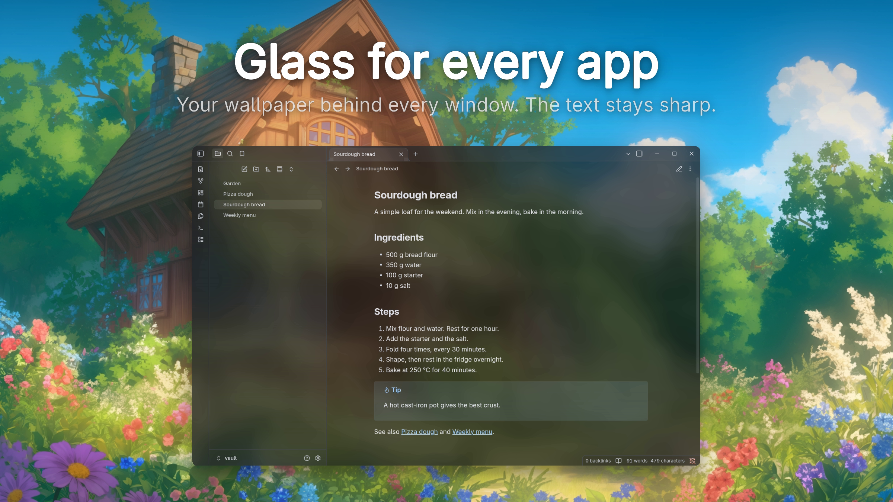
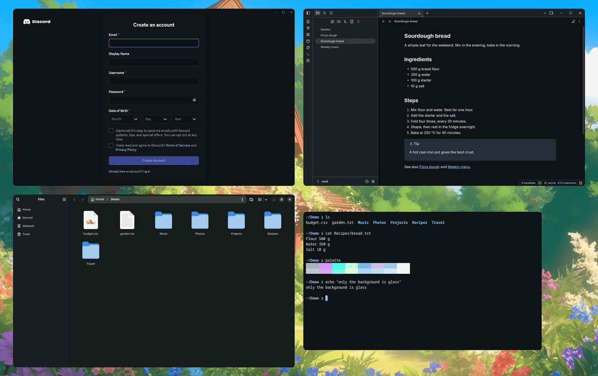
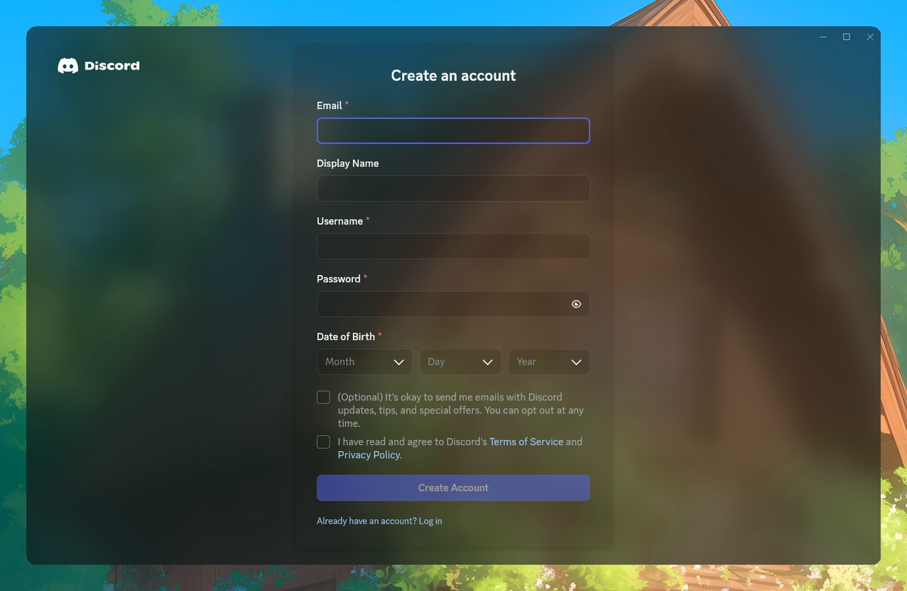
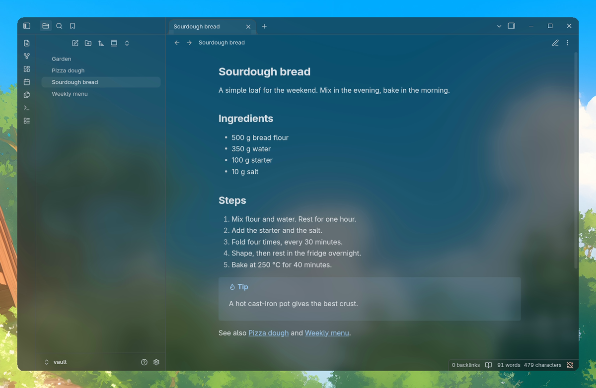
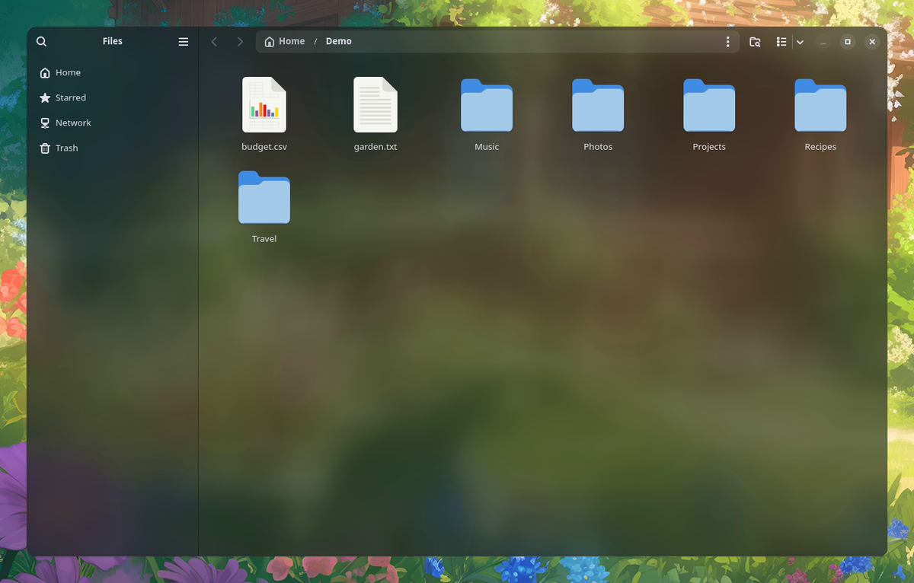
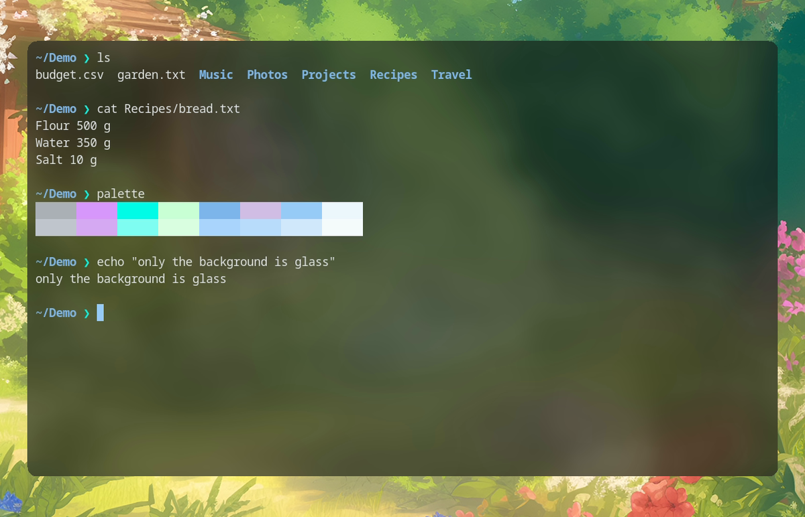

<div align="center">



**Glass backgrounds for your desktop apps on [DMS](https://github.com/duxlabs-dev/dux-shell) + niri.**

Discord, Obsidian, Files, your terminal: the wallpaper shows through, the text stays sharp.
One glass level for every app, taken from your DMS window opacity.

[Getting started](#getting-started) · [What it looks like](#what-it-looks-like) · [Features](#features) · [Usage](#usage) · [Settings](#settings) · [Troubleshooting](#troubleshooting) · [Roadmap](#roadmap) · [User guide](docs/guide.md) · [Changelog](CHANGELOG.md)

</div>

> [!NOTE]
> **Early version.** appGlass works today for the apps marked **Works** in the [route table](#which-apps-get-glass). Some routes wait for a hidden check before they go live. Apps with no route stay opaque and sharp.

## What it looks like



*Before: the same windows, opaque. After: appGlass on.*

| Discord (Vencord) | Obsidian |
| --- | --- |
|  |  |
| **Files (Nautilus)** | **Alacritty** |
|  |  |

All shots come from a test session with demo files only: no account is logged in.

## Getting started

### Requirements

DMS 2.0.0 or newer, niri and Python 3.11 or newer. Some apps need more tools:

<details>
<summary>All dependencies</summary>

| Dependency | Version | Needed for |
| --- | --- | --- |
| DMS (Dux Modular Shell, formerly DankMaterialShell) | 2.0.0 or newer | The glass level and the settings page |
| niri | Any recent version | The window rules |
| Python | 3.11 or newer, standard library only | Everything (`appglass` is a Python program) |
| `gcc` | Any | The small C shims (Lian Li and the other WebKitGTK apps, LocalSend, ArtCraft) |
| EGL headers (`EGL/egl.h`) | Any | The colour-key shim (LocalSend, and ArtCraft when its Vulkan layer cannot run) |
| Vulkan headers (`vulkan/vk_layer.h`) | Any | The Vulkan layer (ArtCraft) |
| `g++`, Qt 6 headers, `moc` and `pkg-config` | Qt 6 | VLC (its Qt style plugin is built from source) and the Qt shims |
| Host Qt | 6.11 or newer | Jellyfin Desktop only |
| A DMS window rule with an opacity | No match, blur on | The glass level itself (optional, see below) |
| `gamescope`, `niri`, `dbus-run-session` and `ffmpeg` | Any | The hidden check of the Forced and Mod routes. Without them the check cannot run, and those routes stay plain |
| `bwrap` (bubblewrap), with user namespaces | Any | Every hidden check (host and flatpak apps alike): each one runs with no network, no system bus and no session bus of yours, in a bwrap namespace. Without it no Forced or Mod app is checked, and those routes stay plain unless you switch them on |
| `jq` | Any | The glass launchers of the Forced routes: Feishin, VSCodium, Lian Li and the other WebKitGTK apps (Kiri, ...), LocalSend, ArtCraft and Jellyfin. Also putting Vencord back after a Discord update, with the Vencord installer CLI kept at `~/.local/share/appglass/VencordInstallerCli-linux` ([how](docs/routes.md#discord-vencord)) |

</details>

**The glass level** is the opacity of your global DMS window rule. Make one in **Settings → Applications → Window rules**: a rule with no match (it applies to every window), an opacity, and blur on. appGlass takes the first such rule, whatever you call it. With no such rule it uses the DMS `foregroundLayerTransparency` setting, then 0.60. A `levels.content` value in appGlass's own settings (`appglass set levels.content 0.80`) overrides the rule; with the DMS plugin, **Follow the DMS rule** on its Glass page clears it again.

### 1. Install

**From the DMS plugin registry** (the easy way): **Settings → Plugins → Browse**, find **App Glass**, click **Install**, then turn it on (step 2). There is nothing to run in a terminal: on its first start the plugin writes the glass files, sets up the theme hook and the user units, and keeps a copy of the CLI so a DMS uninstall can take everything out again. DMS updates the plugin like any other.

**With git** (to follow `master`, or to use the `appglass` command line):

```sh
git clone https://github.com/lung595/appGlass ~/.local/share/appglass
cd ~/.local/share/appglass
bin/appglass plugin install         # link the DMS plugin into the DMS plugins folder
bin/appglass hook install           # re-apply on every DMS theme or level change, and route new apps
bin/appglass apply --all --dry-run  # preview: the files it would write; changes nothing
bin/appglass apply --all            # write the glass files for every app it supports
```

To type `appglass` instead of `bin/appglass`, link it into your PATH:

```sh
ln -s ~/.local/share/appglass/bin/appglass ~/.local/bin/
```

The rest of this page writes `appglass` for short.

<details>
<summary>Updating</summary>

```sh
cd ~/.local/share/appglass && git pull
appglass doctor --fix   # the hook and units, as the new version writes them
appglass apply --all    # the glass files, as the new version writes them
dms restart             # reload the plugin's code; your settings are kept
```

Then restart the apps whose glass changed.
</details>

### 2. Enable

In **Settings → Plugins**, turn **App Glass** on. If it does not show up, click **Settings → Plugins → Manage Registries → *Scan***.

### 3. Add a widget

The widget is optional. The glass works without it.

**Settings → Bar widgets → Add widget**, then pick **App Glass**. The bar pill shows how many apps are on glass. A click opens the settings. A right click pauses or resumes the glass.

### 4. First steps

1. **Restart your apps.** Most apps read their colours only when they start. Alacritty, Herdr and Dux Files reload live.
2. **Quit Obsidian before the first apply.** It needs one restart the first time. After that it reloads live.
3. Open **Settings → Plugins → App Glass → Apps** to see which app got which route.

## Features

| The level follows DMS |
| --- |
| [](docs/media/levels.gif) |
| *The DMS window rule opacity at 0.90, 0.75 and 0.60.* |

| A new app gets glass |
| --- |
| [](docs/media/new-app.gif) |
| *The window opens with glass. No command needed.* |

The GIFs are crossfades between real screenshots, taken in a separate test session. The level label in the first GIF was added afterwards. The music window is a small libadwaita demo app: it gets its glass from the GTK4 CSS that libadwaita apps read, so it needs no routing. Plain GTK4 apps without libadwaita stay opaque (not tested). Apps of other toolkits are routed by the sync unit within seconds.

- **Only the background turns glass.** niri keeps the window at `opacity 1.0` (0.999 for the few apps whose window says it is opaque: Feishin, VSCodium, Obsidian and the WebKitGTK apps, so niri still draws what is behind them). Each app paints its own background with alpha. Text, icons and logos stay fully opaque.
- **Three levels, from one number.** Content follows the DMS level. Bars (header bars, sidebars, tab bars) stay at `max(content, 0.65)`. Menus, popovers and dialogs stay opaque.
- **Colours follow DMS.** A wallpaper or scheme change re-renders the app colours through the matugen hook.
- **An unfocused window looks the same as a focused one.** appglass adds no unfocused fade, and on GTK it keeps Adwaita from greying the text of an unfocused window.
- **New and updated apps are found on their own.** A new app is routed within seconds.
- **Safe by default.** Every file it writes or edits is recorded and backed up first. `appglass remove` puts every file back as it was: the files it created are deleted, the ones it edited get their original bytes back, and an edit you made after appglass is kept. A file appglass owns whole that you edited by hand is saved as `<file>.appglass-changed` before the next apply or hook run writes it again. One exception: while the DMS plugin is on it owns appglass's `settings.json`, and its sync saves the page's settings over a hand edit with no aside (change settings on the plugin's page, or switch the plugin off and use `appglass set`). A link you put over a file it created (to a dotfiles folder) is yours: apply, hook runs, `restore` and remove leave it as is, and its colours no longer follow DMS.
- **Never touched:** games, root GUIs, the windows DMS draws itself, and Firefox-family browsers (those belong to [browserGlass](https://github.com/lung595/browserGlass)).

### Which apps get glass

Each kind of app has a route. In **Settings → Apps**, a row shows the app's route and its kind under the name (for example `gtk4 · Native`). The kind tells you how the app gets its glass:

- **Native**: the app's own colour or theme files. On at once. A failed hidden check never pauses a Native app: it is shown in `appglass status`, the glass stays.
- **Forced**: a small shim or hook, started by a wrapper. On by default, but live only once a hidden check passes.
- **Mod**: a client mod's theme. Same rule as Forced.

The status chip on the right of the row tells you what the app has now:

- **Glass**: the route is applied.
- **Waiting for check**: a Forced or Mod route waits for its first hidden check. The app runs plain until then.
- **Stale**: the app was updated, so its old check no longer counts. The app runs plain until the next check passes.
- **Paused**: the glass is paused, or you switched a Native app off.
- **Conflict**: a hand-made file that appGlass does not own is in the way.
- **Fallback**: no route for this app, its family is not installed or skipped (a `~/.config/gtk-4.0/gtk.css` of your own without the glass import, Obsidian with no vault), the hidden check of a Forced or Mod app failed, its hidden check could not run (could not be checked), or you switched a Forced or Mod app off. It gets the fallback look from **Settings → Fallback**: opaque by default, translucent (text too), or the DMS opacity.
- **Opaque**: kept opaque on purpose, in every fallback mode. The window stays opaque and sharp.
- **Game: never touched**: a game. Opaque, with blur off.
- **Delegated**: owned by someone else: Firefox-family browsers belong to browserGlass. Windows DMS draws itself show as Delegated too. appGlass never touches them.

The status is what [docs/apps.md](docs/apps.md) measured: **Works** (glass, measured in a test session), **Partial** (glass with known gaps, listed there) or **Untested** (only the config writer is tested).

| Route | Kind | Apps | Status |
| --- | --- | --- | --- |
| Terminal opacity key | Native | Alacritty, foot, Konsole | Works |
| Terminal opacity key | Native | kitty, Ghostty, WezTerm | Untested |
| GTK4 CSS | Native | Nautilus, GNOME Text Editor, Mission Center | Works |
| GTK4 CSS | Native | Resources | Works; popups not checked (no menu was opened) |
| GTK4 CSS | Native | GNOME Software, Zenity, the file chooser, Flatseal, other libadwaita apps | Untested: the same CSS, not launched; plain GTK4 apps without libadwaita stay opaque (not tested) |
| GTK3 theme | Native | Solaar, nvidia-settings | Partial: dialog bodies stay opaque |
| GTK3 theme | Native | Other host GTK3 apps | Untested |
| Qt style plugin | Native | VLC, Kate, Konsole (flatpak) | Works |
| Qt style plugin | Native | Other host Qt 6 Widgets apps | Untested |
| App config | Native | Kate (editor theme), mpv, GIMP 3 | Works |
| App config | Native | Zed | Partial: Zed lays its own dark floor under the glass |
| App theme | Native | Obsidian, Herdr, Dux Files, Dux Calendar | Partial: depends on the vault theme (Obsidian), some panes keep their fills (Herdr), bars clearer than content (Dux) |
| Vencord theme | Mod | Discord with Vencord | Untested: expected partial, not measured (Discord needs a signed-in account); needs the Vencord client mod |
| Electron inspector hook | Forced | Feishin | Works, after its check |
| Electron inspector hook | Forced | VSCodium | Works, after its check; popups not checked (no menu was opened) |
| WebKit shim | Forced | Lian Li Linux | Not glass by default: the shim paints the glass, but its hidden check cannot judge it (with its daemon hidden it shows a "Waiting for daemon" dialog), so the check is unverifiable and Lian Li stays opaque until you switch it on (then it stays glass) |
| Generic WebKit shim | Forced | Kiri | Works, after its check (measured on its setup screen) |
| Generic WebKit shim | Forced | Other host GTK3 WebKitGTK 4.x and Tauri apps whose window is the web view | Untested: the same route, not run on another app; native widgets beside the view keep it opaque; WebKitGTK flatpaks and WebKitGTK 6 (GTK4) apps get the fallback |
| Qt Quick shim | Forced | Jellyfin Desktop | Works, after its check |
| Colour-key shim | Forced | LocalSend, ArtCraft Launcher | Works, after its check |
| None | None | Steam, Chrome, Java, Tk, X11 apps of other toolkits, Electron apps with no hook | Fallback: opaque by default, they follow the fallback mode |
| None | None | Games, root GUIs, Qt flatpaks on the KDE runtime (Kate and Konsole excepted) | Opaque: in every fallback mode |

Steam has no route and no switch in **Settings → Apps**: it shows *Fallback* and follows the fallback mode.

What each route writes, and the measured result per app: [docs/routes.md](docs/routes.md) and [docs/apps.md](docs/apps.md).

## Usage

**The glass level.** Change the opacity of your global rule in **Settings → Applications → Window rules** (the first rule with no match and blur on). appGlass sees the change and re-applies.

**A new app.** Install it and open it. The sync unit routes it within seconds. **Re-apply** in Settings → Glass, or `appglass apply --all`, does it at once.

**Pause.** Click **Pause glass** at the top of the settings page, or right click the bar pill. A pause takes the glass files out of every app and keeps the hook. Resume puts the same glass back.

**One app off.** In **Settings → Apps**, switch the app off. A Forced or Mod app loses its files and gets the fallback look. A Native app shows *Paused*, but keeps its files. To take a whole Native family out, use its family name (for example `gtk3`):

```sh
dms ipc call appGlass app gtk3 off
dms ipc call appGlass app gtk3 on
```

**Restart needs.** GTK4 apps and Dux Calendar pick up a change when they restart. GTK3 apps re-read their theme when the sync unit flips the GTK theme (at a DMS colour or level change); after a typed `appglass apply`, restart them. Alacritty, Herdr and Dux Files reload live.

**Uninstall.** **Settings → Advanced → Uninstall appGlass**, then confirm. Or from a terminal:

```sh
appglass remove && appglass plugin remove
```

Every file is put back as it was (files appglass created are deleted, your edits to them too; your later edits to files appglass edited are kept). The hook and the user units go too. Your other DMS plugins are not touched.

**Uninstall from DMS.** Uninstalling App Glass in DMS (Settings → Plugins, or `dms plugins uninstall`) does the same on its own. DMS deletes the plugin's clone, so `appglass hook install` keeps a copy of the CLI in `~/.local/share/appglass/cli` (`$XDG_DATA_HOME` when set; `appglass sync` and a typed `appglass apply` refresh it). When the plugin unloads with its `plugin.json` gone, it runs `python3 -I -B ~/.local/share/appglass/cli/bin/appglass remove --if-gone <plugin.json>`: after 4 s (`APPGLASS_SWEEP_GRACE`) it does nothing if `plugin.json` is back (an update), else it removes everything, the copy last, and a toast says how it went. If that remove fails, the copy stays: run `~/.local/share/appglass/cli/bin/appglass remove` in a terminal. Disabling the plugin or reloading the shell removes nothing. Then delete the clone if you like, and the link you made in Install:

```sh
rm ~/.local/bin/appglass
```

## Settings

Open **Settings → Plugins → App Glass**. A search field sits on top (**Ctrl+F** or **/**). The pages are on the left.

| Page | What is there |
| --- | --- |
| **Glass** | **Glass for desktop apps** (the main switch), **Glass level** (read-only, from DMS), **Follow the DMS rule** (shown when appglass's own settings hold a level), **Apps on glass**, **Re-apply** |
| **Apps** | The **App list**: one row per app, with its status chip, route and kind, reason and switch |
| **Fallback** | **Apps without glass**: Opaque (default), Translucent (text too), or DMS opacity. **Fallback opacity** (50 to 100 %, default 70 %) |
| **Advanced** | **Learn open windows**, **Adopt hand-made files**, **Copy report**, **Uninstall appGlass** |
| **About** | **Version**, **Never touched**, **Command line** |

Full details: [docs/plugin.md](docs/plugin.md).

## Command line and keybindings

The DMS plugin answers these calls:

```sh
dms ipc call appGlass status            # the last status, as JSON
dms ipc call appGlass sync              # re-apply from the current settings
dms ipc call appGlass toggle            # pause or resume; answers "glass on" or "glass off"
dms ipc call appGlass pause
dms ipc call appGlass resume
dms ipc call appGlass app <key> on|off  # one app or family
```

Bind one in niri, for example in `~/.config/niri/config.kdl`:

```kdl
binds {
    Mod+Shift+G { spawn "dms" "ipc" "call" "appGlass" "toggle"; }
}
```

The `appglass` command:

```sh
appglass status [--json]                # every app: route, status and reason
appglass levels                         # the current levels, as JSON
appglass detect [--json]                # which toolkit draws each installed app (read-only)
appglass learn [--json] [--dry-run]     # record the toolkit of each open window
appglass apply --all [--adopt] [--dry-run]
appglass apply [--only f1,f2] [--dry-run]
appglass adopt [paths] [--dry-run]      # hand the known hand-made glass files to appglass, backed up first
appglass adopt --rescue                 # state.json lost, none to restore: save its files on disk in a ring entry, record them again
appglass remove [--only f1,f2]          # undo everything, or some families
appglass remove --forget-away           # also forget the files whose folder is gone for good (a deleted vault)
appglass restore [id] [--list]          # the backup ring: the last 5 changes
appglass get [key]
appglass set <key> <value> [--apply]
appglass hook install [--dry-run]
appglass hook remove
appglass plugin install|remove [--dry-run]
appglass doctor [--fix]                 # check appglass's own files
appglass verify <key> | --queue         # run the hidden check now
appglass fail <key> [reason]            # record a failed launch by hand
```

`verify` and `fail` take the key that `appglass status` shows for the app (for example `org.localsend.localsend_app`).

Once the plugin is installed (unless it is disabled in DMS), it owns the settings: `appglass set` refuses and points you to the settings page. Use the page or the IPC calls then. Without the plugin, one app or family goes off with:

```sh
appglass set apps.<key>.enabled false --apply
```

`<key>` is a family name (`gtk3`) or an app key with no dots (`discord`), not an app id like `org.gnome.Nautilus`.

## Troubleshooting

<details>
<summary><b>An app did not change</b></summary>

Restart it. Most apps read their colours only when they start. Then look at its row in **Settings → Apps**: the status and the reason say what happened. `appglass status` shows the same.
</details>

<details>
<summary><b>The app row says <i>Waiting for check</i></b></summary>

Forced and Mod routes run a hidden check first, in a headless session off your screen. Until it passes, the app runs plain. You can run the check now with `appglass verify <key>`. If the check fails, the app stays plain until its next update, and you get one notification.
</details>

<details>
<summary><b>Something looks wrong after an apply</b></summary>

`appglass restore --list` shows the last saved changes. `appglass restore` puts the newest one back, files and state. `appglass doctor` checks appglass's own files, and `appglass doctor --fix` writes back what drifted.
</details>

<details>
<summary><b>appglass says its state is lost</b></summary>

If its state file is gone but its files are still there, appGlass writes nothing and tells you what it found. Run `appglass restore` first. If there is nothing to restore, `appglass adopt --rescue` records the files again. After `appglass remove`, the files it names can be links you put over appglass files (remove leaves them and warns): delete those links, or move them away, and appglass works again.
</details>

<details>
<summary><b>appglass set refuses</b></summary>

The plugin is installed, so it owns the settings, unless it is disabled in DMS. Enabling it is not needed: the link alone is enough. Change the setting on the settings page, or with `dms ipc call appGlass app <key> on|off`. To use `appglass set`, disable the plugin in **Settings → Plugins** first, or remove it with `appglass plugin remove`.
</details>

<details>
<summary><b>Something else</b></summary>

Click **Copy report** in **Settings → Advanced** and paste it in a [new issue](https://github.com/lung595/appGlass/issues). It lists every app's status, route and reason.
</details>

## Privacy

- **It stays in your home folder.** appGlass keeps its files under your home folder and never needs root. While an Electron app starts, its hook uses a private folder (mode 0700) in `$XDG_RUNTIME_DIR`, and the hidden check runs in a temporary folder there.
- **appGlass itself uses no network.** It sends nothing anywhere. One thing it runs can: after a Discord update, the sync unit re-runs the Vencord installer CLI kept at `~/.local/share/appglass/VencordInstallerCli-linux` (when it is there), and the Vencord installer downloads Vencord again. The hidden check runs the app for real, but with no network (its own network namespace: LocalSend does not announce itself on your LAN). The Electron hook opens the app's inspector on 127.0.0.1 only, on a random port, and tries to close it right after the injection. If it cannot, the port stays open on 127.0.0.1 only, while the app runs.
- **Backups first.** Every file it edits is backed up before the first change. If you edit a file after appGlass, `appglass remove` keeps your edit in place in a file it only edited into, and deletes a file it created whole, edits included. For a file you adopted, one whose appGlass part cannot be taken out cleanly, or one `appglass doctor --fix` writes back, the original comes back and your version is saved aside as `<file>.appglass-changed`.
- **It leaves some windows alone.** Games, root GUIs, DMS windows and Firefox-family browsers are never touched. Password managers never get an injected route.
- **The report stays with you.** **Copy report** goes to your clipboard only. It is never sent anywhere.

## Roadmap

These are plans, not promises. They have no dates.

**Next**

- `appglass setup`: the four install steps in one command.
- `appglass pause` and `appglass resume` from the terminal.
- A per-app off for Native apps that takes their files out.
- `appglass set` with app ids that have dots.

**Later**

- A generic Electron route through `NODE_OPTIONS`, for Electron apps with no hook.
- `appglass report <key>`: a scrubbed record for bug reports.
- Filter chips and a "Run check now" button in the settings page.
- WebKitGTK apps: re-mark only the changed part of the page when the body class or the root style changes,
  instead of the whole page.
- The sync unit: follow a moved `FLATPAK_USER_DIR`; reload Herdr with an odd `HERDR_APP_HOME` (`/`, `..`) or a
  relative `XDG_CONFIG_HOME`; compare file times to the nanosecond, so a GTK or Herdr write in the same second
  is not missed.
- `appglass restore` when `XDG_*` or `HERDR_APP_HOME` changed since apply: keep the folders in the ring entry.
- A steady `test_sync_xdg` post-hook race test (it fails now and then, on a busy machine).

## Documentation

| File | Content |
| --- | --- |
| [docs/STATUS.md](docs/STATUS.md) | Project status: what works, what does not, open items, how to resume |
| [docs/guide.md](docs/guide.md) | User guide: install, first run, pause, per-app switch, undo, uninstall |
| [docs/plugin.md](docs/plugin.md) | The settings page, the bar pill and the IPC calls |
| [docs/routes.md](docs/routes.md) | What each route does to each app, with the measured result |
| [docs/engine.md](docs/engine.md) | How appGlass picks a route, and what it never touches |
| [docs/apps.md](docs/apps.md) | Every app tested, with its result |
| [docs/README.md](docs/README.md) | Technical notes, per-toolkit findings and tests |
| [CHANGELOG.md](CHANGELOG.md) | What changed in each version |

## Credits

Built on [DMS](https://github.com/duxlabs-dev/dux-shell) (Dux Modular Shell, formerly DankMaterialShell), [Quickshell](https://quickshell.org) and [niri](https://github.com/niri-wm/niri).

The levels come from [browserGlass](https://github.com/lung595/browserGlass): the bar level of 0.65 and the opaque menus are its own.

## License

[MIT](LICENSE) © lung595

The wallpaper in the screenshots and GIFs is third-party art: it is not covered by the MIT licence.
